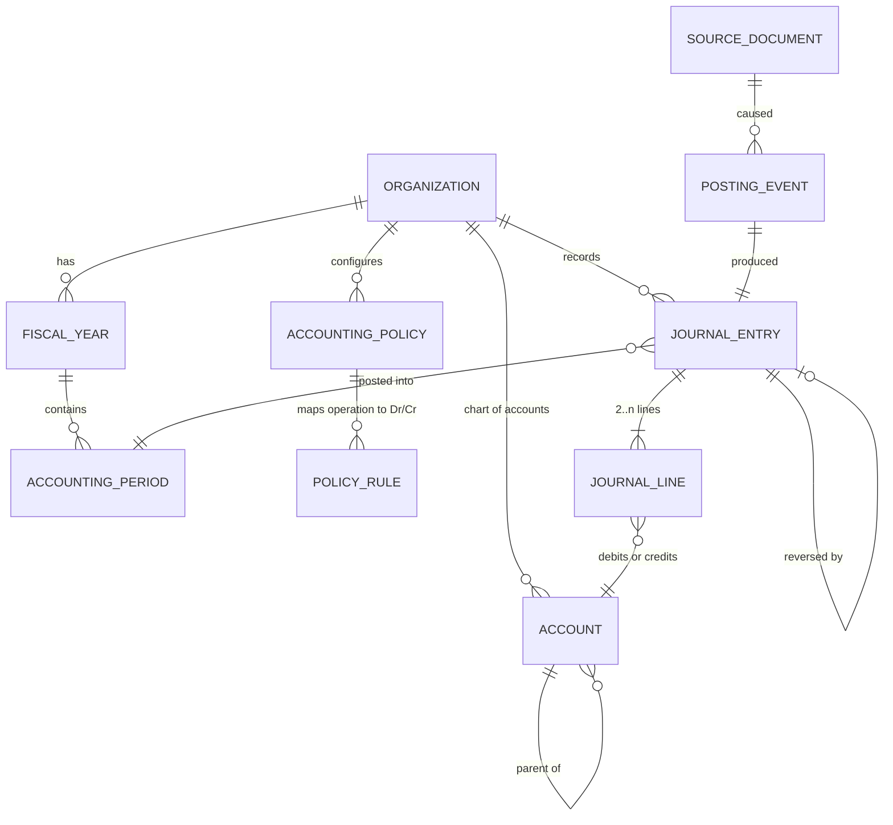

# Accounting design

> **Status: implemented and verified.** The engine, its ten invariants, the
> database triggers that enforce them, the reversal mechanism, policy
> versioning, the trial balance and account statements are all built and
> covered by 59 tests plus a browser-driven walkthrough.
>
> What is *not* built: the policy editor's interface, the balance sheet and
> profit-and-loss statements, cash flow, and opening-balance import. The
> seeded chart's statutory classification remains unconfirmed —
> `OPEN_QUESTIONS.md` question A1.

## Why the engine comes first

Every other module is a producer of accounting events. If the ledger is
correct, a mistake in the sales module is a wrong entry that can be reversed
and traced. If the ledger is wrong, nothing downstream can be trusted and
there is no audit trail to repair it from. So the engine is built first, in
isolation, with its invariants enforced at the database level rather than
only in application code.

## Money

| Decision | Value |
| --- | --- |
| In-memory type | `decimal.Decimal` |
| Database type | `NUMERIC(20, 4)` |
| Rounding | `ROUND_HALF_UP` |
| UZS display scale | 2 (tiyin) |
| Floats | Rejected at the type boundary |

`to_amount()` raises when handed a `float`. This is deliberate: `0.1 + 0.2`
is not `0.3`, and an ERP has no business discovering that in a trial balance.
A test asserts the rejection, and another asserts `app/core/money.py` uses no
float helper.

Four stored decimal places with a two-place currency scale gives headroom for
intermediate values — a VAT extraction, a commission percentage, a payroll
proration — while the *posted* value of a UZS amount is always quantized to
two places first. The legacy workbook already carries amounts such as
`17 020.65` and `3 995 522.66`, so two places is what the existing books use.

### Splitting an amount without losing a tiyin

`allocate(total, weights)` distributes rounding drift one minor unit at a
time, largest weight first, so `sum(allocate(t, w)) == quantize(t)` always
holds. This is what makes a payment allocated across three invoices add back
to the payment. It is property-tested over awkward totals.

## Core entities



### Account

A hierarchical chart: part → section → group → account → sub-account. The
Uzbek national chart (368 rows) ships as reference data in
`backend/app/reference/data/uz_chart_of_accounts.json`.

`level` decides whether a row may carry a posting. Parts, sections and groups
are **structural**: they aggregate their children's balances and must never be
posted to, or a trial balance would double-count them. Only `ACCOUNT`,
`SUBACCOUNT` and `SYNTHETIC` are postable, and `ReferenceAccount.is_postable`
is tested.

`nature` is the statutory debit/credit character — asset, liability/equity,
contra-asset, contra-liability, transit, off-balance. Contra accounts are
represented explicitly rather than as negative balances, because
`0200 Accumulated depreciation` is a credit-nature account that belongs
*under* assets, and flattening that loses the balance sheet's structure.

Accounts are **deactivated, never deleted**. A posted entry references an
account forever; removing one would orphan history.

### JournalEntry and JournalLine

An entry is a balanced set of lines. The legacy workbook's general ledger
(`Бош_китоб`) records exactly one debit account, one credit account and one
amount per row — a two-line entry. The engine supports *n* lines, which is a
strict superset, and the card-payment example below shows why that matters.

`status` is `DRAFT` or `POSTED`. Only `POSTED` affects balances; only `DRAFT`
may be edited.

## The invariants

These ten rules are the contract. Each is enforced in the application *and*,
where a database can express it, in the database — because an application bug
must not be able to produce an unbalanced ledger.

All ten are enforced and tested. The "Database" column names the actual
trigger or constraint; each was verified by bypassing the service and
attempting the violation with raw SQL.

| # | Invariant | Application | Database |
| --- | --- | --- | --- |
| 1 | A posted entry balances | `PostingService._validate_amounts` | `trg_journal_entry_balanced` / `trg_journal_line_balanced`, deferred to `COMMIT` |
| 2 | Total debit equals total credit | Exact `Decimal` equality after quantizing | Same trigger |
| 3 | Lines belong to their entry's organization | Scoped queries | Composite FK `fk_journal_line_entry` |
| 4 | Posted entries are immutable | Service refuses | `trg_journal_entry_immutable`, `trg_journal_line_immutable` |
| 5 | Corrections are reversals, not edits | `PostingService.reverse` | The immutability trigger leaves no alternative |
| 6 | Every posted entry references its cause | `PostingEvent` per posting; a manual entry needs a reason | `source_kind` is `NOT NULL` |
| 7 | Entries have unique traceable numbers | Gapless per-organization sequence under a row lock | `uq_journal_entry_organization_id_entry_number` |
| 8 | Closed periods reject postings | `PostingService.post` | `trg_journal_entry_period_open` |
| 9 | Duplicate events do not duplicate postings | Lookup, then insert | `uq_posting_event_source` — the guarantee under concurrency |
| 10 | Failed postings roll back atomically | One transaction per service call | PostgreSQL transactions |

A note on invariant 1. Balance is a property of a *set* of rows, so it cannot
be a `CHECK`. It is a `CONSTRAINT TRIGGER ... DEFERRABLE INITIALLY DEFERRED`
that fires at commit time, by which point all the lines exist. That also means
a service may insert the entry and its lines in any order.

An eleventh guarantee emerged while building: **a structural account cannot
be posted to**. `journal_line.account_is_postable` is filled by a trigger from
the referenced account — never by the caller — and a `CHECK` requires it to be
true. A caller cannot assert postability an account does not have, so a
posting to a part, section or group is unrepresentable rather than merely
refused.

A note on invariant 3. The composite foreign key is the interesting one.
`journal_line (organization_id, journal_entry_id)` references
`journal_entry (organization_id, id)`, so a line whose organization differs
from its entry's is *unrepresentable* — not merely rejected by a check that
code might forget to call. The same pattern already guards `membership_role`
in Phase 1, and a test inserts the offending row by raw SQL to prove the
database refuses it.

### Line-level checks

```sql
CHECK (debit >= 0 AND credit >= 0)
CHECK (NOT (debit > 0 AND credit > 0))   -- one side only
CHECK (debit > 0 OR credit > 0)          -- no zero lines
```

Negative amounts are not allowed. "Credit 500" and "debit −500" are the same
economic fact with two representations, and permitting both means every report
has to handle both. One representation, enforced.

## Corrections

A posted entry is never edited. Two mechanisms:

**Reversal.** Creates a new entry with debits and credits exchanged, dated in
an open period, linked both ways. The original stays visible. Requires
`accounting.journal.reverse` and a reason, and is audited.

**Reversal plus replacement.** For a corrected amount: reverse, then post the
right entry. Two traceable entries rather than one silently-mutated one.

Why not allow edits in an open period, where no statutory report has been
filed? Because "no report has been filed" is a judgement the system cannot
verify, and the moment edits are possible the audit trail stops being
evidence. The cost is one extra entry per correction.

## Accounting policies

The legacy workbook's `Учетная_политика` sheet maps 77 operation types to
debit and credit account pairs — "cash service rendered" → Dr 5010 / Cr 9030.
That mapping is the right idea and is the model for `AccountingPolicy`.

Requirements, each of which the workbook's version lacks:

- **Organization-specific.** One tenant's mapping is not another's.
- **Versioned with effective dates.** A rule change applies from a date
  forward.
- **Validated before activation.** Both accounts must exist, be postable, and
  belong to the organization.
- **Restricted.** Only `accounting.policy.manage`, which only the owner role
  holds.
- **Audited.** Every change records who, when, why, and the before/after.

**A policy change must never rewrite a posted entry.** A posted entry stores
the resolved account ids and the policy version that produced them. Changing
the policy changes future postings only. This is the single most important
property of the design: in the workbook, editing the policy sheet silently
changes what every historical row appears to say, because the Dr/Cr columns
are `INDEX/MATCH` formulas rather than stored values. See
`LEGACY_WORKBOOK_MAPPING.md`.

## Worked examples

### A cash payment

A patient pays 300 000 UZS in cash for a completed treatment.

| | Account | Debit | Credit |
| --- | --- | --- | --- |
| | 5010 Cash in hand | 300 000.00 | |
| | 9030 Revenue from services | | 300 000.00 |

One posting event, keyed on the payment. Expected cash for the open session
rises by 300 000.

### A card payment with a bank commission

A patient pays 500 000 by card. The bank retains 5 000 and settles 495 000.

The requirement is that the gross payment, the settlement and the fee are
represented **separately**, and that the clinic's revenue is 500 000 — not
495 000, and not 995 000 from double-counting the stages.

Three distinct events:

**1. Payment taken.** The patient has paid; the acquirer owes the clinic.

| Account | Debit | Credit |
| --- | --- | --- |
| 5110.03 Card settlement receivable (transit) | 500 000.00 | |
| 9030 Revenue from services | | 500 000.00 |

**2. Settlement received and reconciled.** The bank pays 495 000 and keeps
5 000, and the clinic learns both facts from the statement line. So this is
one event, not two: matching the line is what records the settlement.

| Account | Debit | Credit |
| --- | --- | --- |
| 5110.01 Bank current account | 495 000.00 | |
| 9420 Administrative expenses (bank fee) | 5 000.00 | |
| 5110.03 Card settlement receivable | | 500 000.00 |

> **As built**, this is posted as two balanced entries rather than one
> three-line entry — the net settlement and the fee — because each is keyed to
> the match that caused it and is therefore separately traceable and
> separately idempotent. The accounts and amounts are exactly those above, and
> a many-to-one match produces one settlement entry per record plus one fee
> entry for the line. See ADR-033.

What matching does **not** produce is a revenue entry. The economics of the
sale were recorded in event 1; the statement line only moves money out of the
transit account. That is the sense in which matching is a reconciliation
fact rather than a financial one.

Revenue is recognised once, at 500 000. The transit account returns to zero
when settled, so a non-zero balance there *is* the list of unsettled card
payments. That is what makes the account worth having.

This also shows why *n*-line entries matter: event 2 has three lines and
cannot be expressed as a single debit/credit pair.

> The legacy workbook instead grosses up from the net receipt
> (`net / (1 − commission%)`). That recovers the right revenue figure but
> never records the fee as an expense, and it cannot represent one settlement
> covering several payments. See `OPEN_QUESTIONS.md` question B2 for the
> commission rates actually charged.

### An advance payment

A patient pays 1 000 000 toward treatment not yet performed.

| Account | Debit | Credit |
| --- | --- | --- |
| 5010 Cash in hand | 1 000 000.00 | |
| 6310 Advances received from customers | | 1 000 000.00 |

**No revenue.** An advance is a liability — the clinic owes treatment. Revenue
is recognised when the service is completed, by a separate entry releasing the
advance. Conflating the two overstates revenue and understates liabilities,
and the system treats them as different events for exactly that reason.

## Reports

All reports derive from posted journal lines. No report total is ever stored
as an independent source of truth; a stored total is a second version of the
facts, and the two diverge.

| Report | Basis |
| --- | --- |
| Trial balance | Sum of debits and credits per account over a period |
| General ledger | Lines per account in date order with a running balance |
| Account statement | One account, opening balance, movements, closing balance |
| Balance sheet | Account balances rolled up the hierarchy to statutory lines |
| Profit and loss | Revenue and expense accounts for the period |
| Cash flow | **Indirect method** — see below |
| AR / AP ageing | Open receivable and payable items bucketed by age |

### Cash flow method

The **indirect** method: start from the period's profit, adjust for non-cash
items (depreciation, provisions) and for changes in working capital. Chosen
because it derives entirely from the ledger. The direct method requires every
cash movement to be classified as operating, investing or financing at the
point of entry — a classification the clinic does not currently record, and
one that would need an accountant's rules first.

This choice is recorded in `DECISIONS.md` and is revisitable; the statutory
form required for Uzbek filing is `OPEN_QUESTIONS.md` question A3.

### Statutory forms

The workbook contains a Form No. 1 balance sheet template whose line codes
(010, 011, 012, …) map to account ranges — line 010 is account group 0100,
line 340 is 5100, and so on. That mapping is a data-driven report definition
and is the intended Phase 6 implementation: a `ReportLineDefinition` table of
line code → account set → sign.

The template in the workbook is **not** assumed current. The form and its line
mapping are `OPEN_QUESTIONS.md` question A2.

## Concurrency

The scenario that must not happen: two cashiers process the same payment
simultaneously and it is applied twice.

Four mechanisms, in order of reliability:

1. **Idempotency keys.** A posting event is unique on
   `(organization_id, source_kind, source_id, purpose)`. The second insert
   violates the constraint and its transaction fails. This is the primary
   defence, and it works regardless of timing.
2. **Row locks.** `SELECT ... FOR UPDATE` on the invoice before allocating a
   payment, so two allocations serialise.
3. **Allocation constraints.** Total allocated against an invoice may not
   exceed its total, checked under that lock.
4. **Transaction boundaries.** One service call, one transaction.

A preliminary availability check is never relied on alone. "Is this already
posted?" followed by "post it" is two statements with a gap between them, and
the gap is exactly where the duplicate appears. The uniqueness constraint
closes the gap; the check only improves the error message.

## What needs an accountant

The engine's *mechanics* — balance, immutability, idempotency, reversal — are
general double-entry bookkeeping and are not in doubt. What needs confirmation
is the **classification**: which account a given operation posts to, whether
dental services bear VAT, which statutory form applies, and what the current
payroll rates are.

The code is structured so those answers are configuration rather than logic.
`OPEN_QUESTIONS.md` lists each one, and no default is invented in the
meantime.
