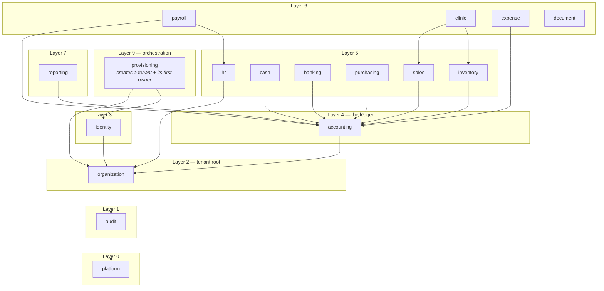
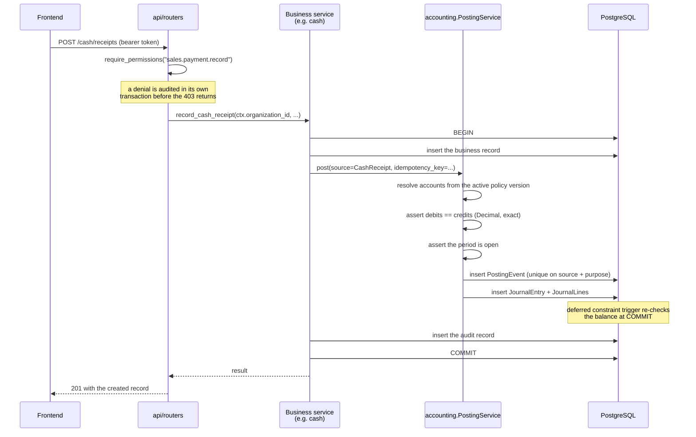

# Architecture

## Shape

A modular monolith: one deployable backend, one frontend, one database.
Modules are separated by dependency rules that are **tested**, not merely
documented, so the boundaries survive contact with a deadline.

Microservices are not used and are not planned. There is no scaling pressure —
a dental clinic generates on the order of a thousand fiscal receipts a year —
and splitting a double-entry ledger across network boundaries trades a
transaction for a distributed-consistency problem. That is a bad trade when
the invariant at stake is "debits equal credits".

## Layers

```
┌──────────────────────────────────────────────────────────┐
│ app/api         HTTP. Routers, dependencies, middleware. │
│                 Authorises, never decides business rules.│
├──────────────────────────────────────────────────────────┤
│ app/modules     Bounded business modules. Application    │
│                 services own transactions and invariants.│
├──────────────────────────────────────────────────────────┤
│ app/core        Config, database, money, permissions,    │
│                 logging, errors, tenancy, context.       │
└──────────────────────────────────────────────────────────┘
```

Two rules hold this together, both enforced by
`backend/tests/test_module_boundaries.py`:

1. **`core` never imports a module.** It is infrastructure; the arrow points
   one way.
2. **A module never imports a higher layer, and never another module's
   `models`.** Cross-module reads go through a service call, so the module
   that owns a table keeps control of its invariants.

## Module dependency graph

Layer numbers come from `MODULE_LAYERS` in the boundary test. An edge may only
point downward.



Three placements are worth justifying.

**`organization` sits below `identity`.** The organization is the tenant
boundary that every other record is scoped to, so it is more fundamental than
the users attached to it. Identity reaches it through `OrganizationService`,
never through its models.

**`provisioning` sits above both.** Creating an organization *and* installing
its first authorised person is one transaction spanning two modules. Putting
it inside either would create a cycle, so it lives in a module above both
whose only job is to compose them. This is the shape to reuse whenever a use
case spans modules.

**`accounting` sits below every business module.** Sales, cash, banking,
purchasing, inventory and payroll all *post* to the ledger, so they depend on
it; it depends on none of them. That is what lets the accounting engine serve
a business that is not a dental clinic.

## How a business event reaches the ledger

No business module writes to an accounting table. It builds a posting request
and hands it to the accounting service, which is where the balance, period and
idempotency checks live. A test asserts that no module imports
`accounting.models`, so this cannot be shortcut under pressure.



If anything in that sequence fails, the whole transaction rolls back — the
business record, the journal entry and the audit row together. A ledger with a
business record but no posting, or a posting with no audit trail, is a worse
outcome than an error message.

## Request pipeline

Middleware is listed outermost first.

| Stage | Responsibility |
| --- | --- |
| `SecurityHeadersMiddleware` | Stamps security headers, including onto error responses |
| `CORSMiddleware` | Restricts origins to the configured list |
| `RequestContextMiddleware` | Assigns a request id; binds it to every log line |
| `get_context` dependency | Decodes the bearer token into a `RequestContext` |
| `require_permissions(...)` | The single authorization gate; audits denials |
| Router | Validates input, calls a service, returns a response model |
| Exception handlers | Map `DomainError` to a uniform JSON envelope |

An unexpected exception returns a generic 500 carrying only the request id.
Internal messages and stack traces never reach a client; the request id is how
an operator finds the real cause in the logs.

### Where the organization comes from

`RequestContext.organization_id` is read from the signed access token and from
nowhere else. No endpoint accepts an organization id in a path, query or body.
There is therefore no identifier for a caller to substitute, which is a
stronger guarantee than validating one would be.

## Authorization model

Authority attaches to a **membership** — the pair (user, organization) — not
to a user. The same accountant can be an accountant in one clinic and an
auditor in another, and a cross-organization privilege is not expressible.

```
User ──< Membership >── Organization
            │
            └──< MembershipRole >── Role ──< RolePermission >── Permission
```

`app/core/permissions.py` is the single source of truth: 67 permissions named
`<module>.<object>.<action>`, nine system roles, and the
segregation-of-duties pairs. Migrations seed the database from it, the API
enforces against it, and the frontend reads the resolved set only to decide
what to render.

Segregation of duties is checked at two points, because a conflict can arise
from a combination that each role permits alone:

- when a role's permission set is defined, and
- when roles are granted to a membership, against the **union** of their
  permissions.

The organization owner is exempt. A single-owner MChJ has nobody to delegate
approval to; the audit trail is what makes those actions reviewable instead.

## Frontend

React + TypeScript + Vite, TanStack Query for server state, React Hook Form
with Zod for forms, Tailwind for styling. Uzbek is the default language, with
Russian and English; all text lives in `src/i18n/`, and `en.ts` and `ru.ts`
are type-checked against `uz.ts` so a missing key fails the build.

The frontend is **not** a security boundary. It mirrors backend permissions to
avoid offering actions that would be refused, and the authorization tests call
the API directly — bypassing the UI entirely — to prove the real boundary
holds.

### Honest module state

`GET /api/v1/platform/modules` returns each module's real implementation
status from a registry in the backend. The navigation marks unfinished
modules, and opening one shows what is built and what is not. The frontend may
not hard-code this, and the integration tests assert that nothing beyond
Phase 1 reports itself as `available`.

This matters more than it sounds. A polished screen whose buttons do nothing
misleads the people deciding whether to run their business on the system.

## Technology choices

| Area | Choice | Why |
| --- | --- | --- |
| API | FastAPI | Typed request/response models and generated OpenAPI |
| ORM | SQLAlchemy 2.x, async | Composite foreign keys and raw DDL where needed |
| Migrations | Alembic | CI verifies the schema matches the models and reverses |
| Database | PostgreSQL | `NUMERIC`, deferred constraint triggers, partial indexes |
| Money | `Decimal` → `NUMERIC(20,4)` | Binary floats are rejected at the type boundary |
| Cache / queue | Redis + Celery | Rate limiting now; statement imports and reports later |
| Auth | Argon2id + JWT access + opaque refresh | See `docs/SECURITY.md` |

Relationships are declared `lazy="raise_on_sql"`. In async SQLAlchemy an
implicit lazy load fails with an unrelated greenlet error far from its cause;
this turns that into a loud, local error and forces every read to state how it
loads its data.
