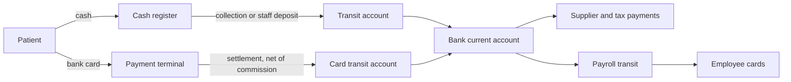
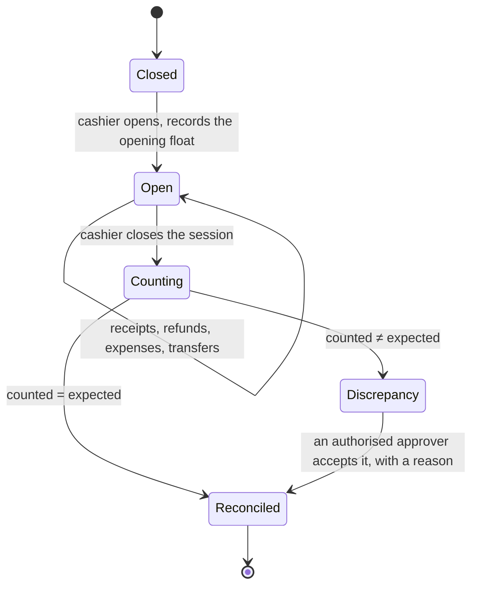
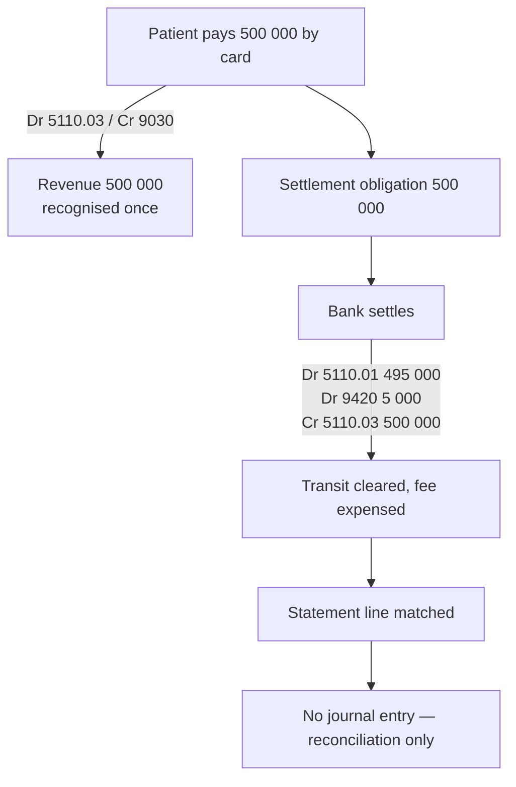
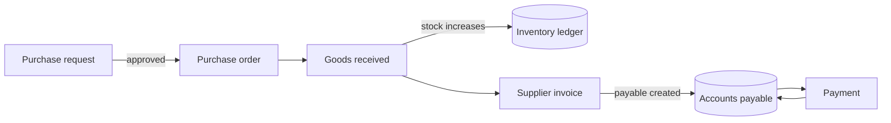
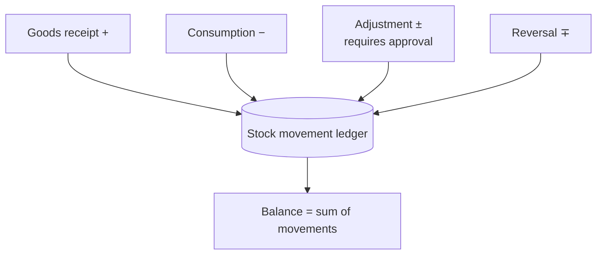
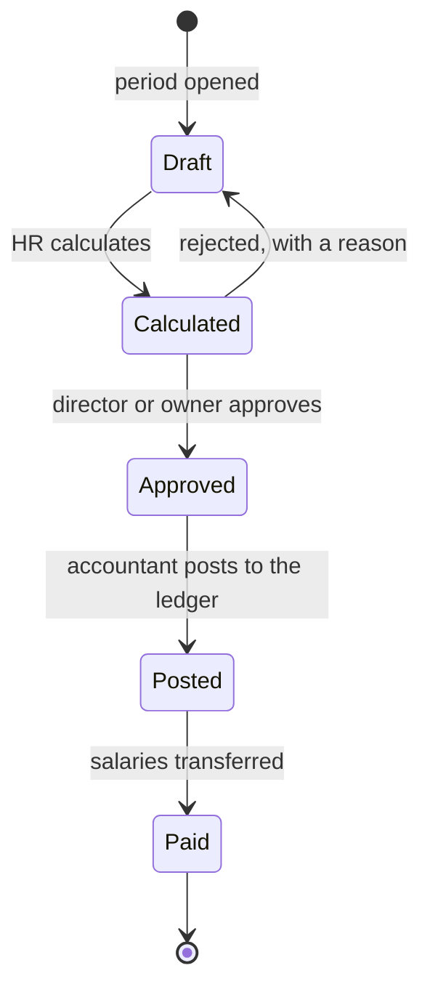
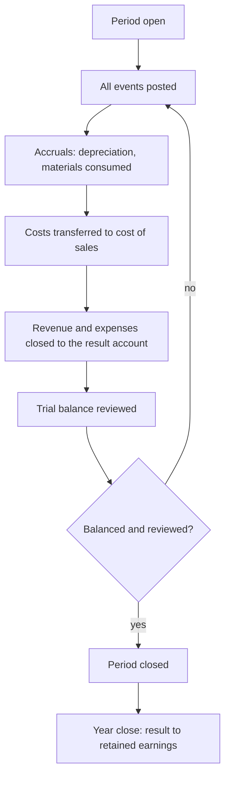
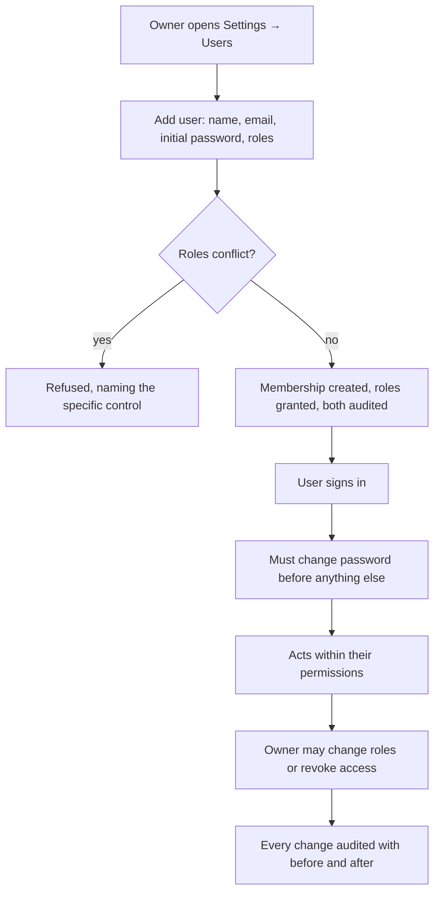

# Business processes

How the clinic works today, how the system will model it, and where the two
differ. Current practice is reconstructed from the reference workbook — see
`LEGACY_WORKBOOK_MAPPING.md` for the evidence behind each claim.

> Processes below are marked **Phase 1** (implemented), or by the phase that
> will deliver them. Nothing marked Phase 2+ exists yet.

## The money paths

Two, with very different volumes. In 2025, cash was about 96% of receipts by
value and card about 4%.



The transit accounts are not an accounting nicety. Money genuinely sits
somewhere between the till and the bank, and between the terminal and the
bank, and the clinic's existing books already model that with accounts 5710
and 5110.03/5110.04. A non-zero transit balance *is* the list of unsettled
items, which is what makes reconciliation possible.

## 1. Treatment to cash in the bank · Phase 3 — billing implemented

The core revenue process. Five distinct records for one economic event, and
the system must not count any of them twice.

```mermaid
sequenceDiagram
    actor Patient
    participant Rec as Receptionist
    participant Dent as Dentist
    participant Cash as Cashier
    participant Led as Ledger
    participant Bank

    Patient->>Rec: arrives
    Rec->>Rec: register or find the patient
    Rec->>Rec: book an appointment
    Dent->>Dent: perform treatment
    Dent->>Led: mark the service completed
    Note over Led: service completion ≠ revenue
    Led->>Led: issue an invoice
    Note over Led: Dr receivable / Cr revenue
    Patient->>Cash: pay
    Cash->>Led: record the payment, allocated to the invoice
    Note over Led: Dr cash / Cr receivable
    Cash->>Cash: fiscal receipt printed
    Cash->>Cash: close the cash session, count the money
    Cash->>Bank: deposit
    Led->>Led: Dr transit / Cr cash
    Bank-->>Led: statement line
    Led->>Led: match it; Dr bank / Cr transit
```

### Five events that are not interchangeable

The specification is emphatic about this and the workbook shows why: treating
them as one would multiply turnover severalfold.

| Event | What changes | Accounting effect |
| --- | --- | --- |
| Service completed | Clinical record | **None** |
| Invoice issued | Receivable created | Dr receivable / Cr revenue |
| Fiscal receipt printed | Statutory record | **None** — evidence, not an event |
| Payment collected | Cash or transit rises | Dr cash / Cr receivable |
| Bank statement matched | Reconciliation status | Dr bank / Cr transit |

Revenue is recognised **once**, at invoice issue. A fiscal receipt is
statutory evidence that a payment happened; it is not a second sale.

### Where the clinic may simplify

If payment is always on completion — `OPEN_QUESTIONS.md` S1 — then completion,
invoice and payment collapse into one moment, and the system will post the
combined entry while still recording the three events separately. The
distinction stays available if instalments are ever accepted, rather than
needing a rebuild.

### What is built today

Invoice issuance, payment collection and allocation all work and post to the
ledger. The fiscal receipt and the bank statement match are Phase 3b.
Service *completion* as a clinical event is Phase 3c, pending the access
rules in `OPEN_QUESTIONS.md` C1; until then an invoice is raised directly.

A worked example, verified end to end: a 300 000 invoice, a 120 000 part
payment, then 500 000 applied oldest-first. The ledger ends with cash
620 000, an advance liability of 320 000, revenue of 300 000 and no
receivable. Revenue was recognised once, at issue.

## 2. Cash session and daily close · Phase 3



Worked example from the specification: a patient pays 300 000 UZS in cash. The
system records the payment, associates it with the service or receivable, and
raises expected cash by 300 000. At close, the cashier enters the physically
counted amount. The system compares and records any difference.

Rules:

- Expected cash is computed from recorded movements. It is never an editable
  field — see `OPEN_QUESTIONS.md` B1 for who may do what.
- A discrepancy is recorded, not silently absorbed. It needs an approver with
  `cash.discrepancy.approve`, and a cashier may not approve their own
  (a segregation-of-duties pair).
- A posted cash transaction is never deleted. Mistakes are reversed.
- Only one session may be open per register at a time.

## 3. Card payment, settlement and reconciliation · Phase 3

The specification's example: 500 000 paid by card, 5 000 commission, 495 000
received. The gross payment, the settlement and the fee must be represented
separately, and revenue must be 500 000.



The journal entries are in `ACCOUNTING_DESIGN.md`.

### Matching must be many-to-one

The clinic already works this way: its workbook sums several fiscal receipts
against one bank settlement line and shows the difference. So matching
supports one-to-one, one-to-many and many-to-one.

Rules:

- An unmatched bank transaction is **never** marked reconciled.
- Duplicate statement lines are detected on import, not after posting.
- Unmatched items sit in a visible queue rather than disappearing.

## 4. Purchase to payment · Phase 4

Four separate records, because they genuinely happen at different times and
conflating them is how payables get lost.



| Record | Accounting effect |
| --- | --- |
| Purchase request | None |
| Purchase order | None — a commitment, not a liability |
| Goods received | Dr inventory / Cr goods-received-not-invoiced |
| Supplier invoice | Dr goods-received-not-invoiced / Cr payable |
| Payment | Dr payable / Cr bank |

Receiving goods and receiving the invoice are separate on purpose: materials
often arrive before paperwork, and the interim liability is real.

The person who raises an order may not approve it — a segregation-of-duties
pair.

## 5. Inventory · Phase 4

Stock is **never** a stored editable quantity. The balance is the sum of an
auditable movement ledger, for the same reason a trial balance is not a stored
total: an editable field and a movement history will diverge, and then nobody
knows which is right.



Rules:

- Negative stock is refused unless explicitly authorised.
- An adjustment needs `inventory.adjustment.approve` and a reason.
- A reversal restores exactly the quantity its original moved.
- A duplicate receiving event is rejected by its idempotency key.
- Batch and expiry are tracked per product where required
  (`OPEN_QUESTIONS.md` I2).

Whether material use is recorded per treatment or by periodic stock-take is
`OPEN_QUESTIONS.md` I3 — for a clinic, per-treatment recording may not be
realistic, and the honest answer shapes the design.

## 6. Payroll · Phase 5



Rules:

- The person who calculates may not approve — a segregation-of-duties pair.
- Posting requires approval first. There is no path from Calculated to Posted.
- Statutory calculations use the rule version in force for the payroll
  period, not the current one, so recalculating an earlier period is correct.
- Re-running a calculation does not duplicate liabilities (idempotency key on
  the run).

Compensation may be fixed, commission-based, or both. **Commission
eligibility is explicit**: a percentage of *completed treatments* and a
percentage of *collected payments* are different numbers whenever a payment is
late or never arrives, and the system will not treat them as equivalent.
`OPEN_QUESTIONS.md` P3 asks which the clinic uses.

Current payroll tax rules must be supplied before this runs
(`OPEN_QUESTIONS.md` P2). The workbook's 2018 rates are not used.

## 7. Expenses · Phase 5

The rule that matters: **not every outgoing payment is an expense.** The
workbook's bank statement shows all of these leaving the account, and they
have different accounting consequences.

| Outgoing payment | Actually is |
| --- | --- |
| Electricity, telephone, waste collection | Operating expense |
| Advance to a supplier | An asset — a receivable |
| Dental materials purchase | Inventory |
| Equipment purchase | A fixed asset, then depreciation |
| Loan repayment | Reduces a liability |
| Transfer to the payroll transit account | Moves cash; not an expense |
| Tax payment | Settles a liability accrued earlier |
| Bank commission | Operating expense |

Classifying all of these as expenses would overstate costs, understate assets,
and make the balance sheet wrong. So the expense module requires an explicit
classification and the accounting policy maps each to its accounts.

## 8. Period close · Phase 2 and 6



The workbook's policy sheet already encodes these steps — depreciation
(Dr 2010 / Cr 0200), materials consumed (Dr 2010 / Cr 1010), cost transfer
(Dr 9130 / Cr 2010), closing entries to 9910, and the year-end transfer to
8710. They become scheduled, auditable operations.

A closed period rejects new postings. Reopening needs
`organization.period.manage` and is audited with a reason.

## 9. User and access administration · Phase 1 — implemented

The one process that works end to end today.



Implemented and verified:

- A new user must change their password before reaching the application — the
  initial password was chosen by someone else, so until it is replaced two
  people know it.
- A role grant that breaks a segregation-of-duties control is refused, naming
  the rule.
- The primary owner cannot be deactivated or demoted; an organization with
  nobody authorised over it is not a valid state.
- Deactivating a membership revokes access to that organization and leaves the
  user's other memberships alone.
- Changing a password ends every other session for that user.

## Approvals, in one place

| Action | Requires | May not be done by |
| --- | --- | --- |
| Post a journal entry | `accounting.journal.post` | — |
| Reverse a posted entry | `accounting.journal.reverse` + reason | — |
| Change accounting policy | `accounting.policy.manage` (owner only) | — |
| Close or reopen a period | `organization.period.manage` | — |
| Approve a cash discrepancy | `cash.discrepancy.approve` | the cashier who ran the session |
| Approve a refund | `sales.refund.approve` | the requester |
| Approve a purchase order | `purchasing.order.approve` | the person who raised it |
| Approve an expense | `expense.request.approve` | the submitter |
| Approve payroll | `payroll.run.approve` | the person who calculated it |
| Approve a stock adjustment | `inventory.adjustment.approve` | — |

The owner role is exempt from the "may not" column — see ADR-018. The audit
trail is the compensating control.
