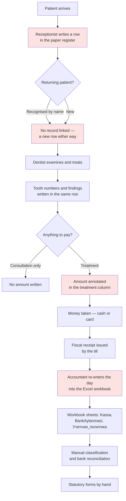
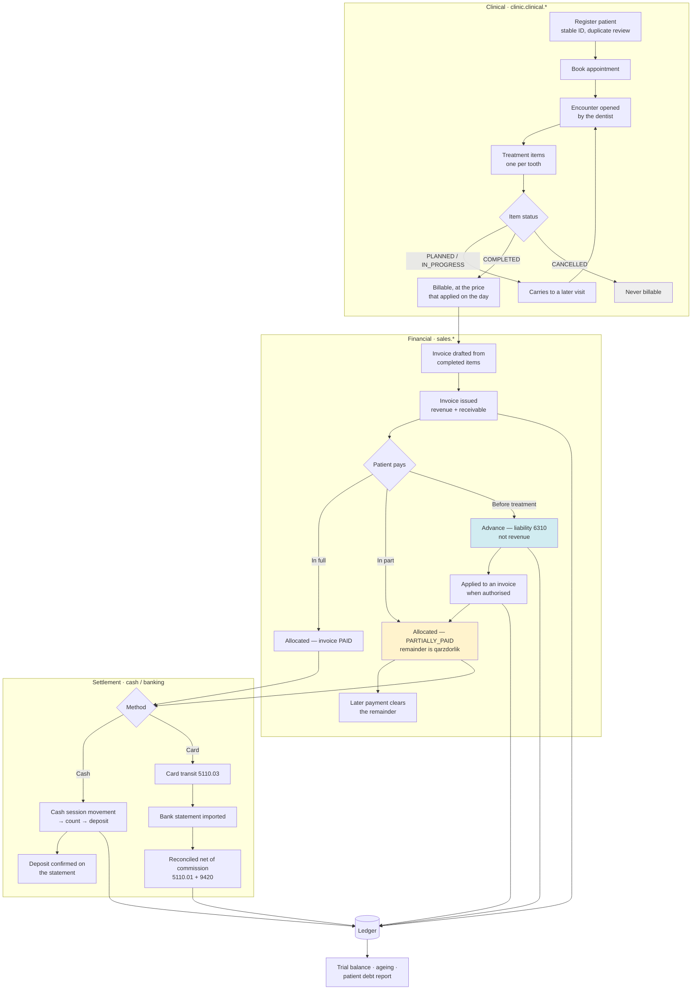

# Clinic process analysis — patient to accounting

**Date:** 2026-10-31 · **Status:** analysis complete; implementation complete through step 13 of section G

A reassessment of the existing implementation against three sources of
evidence: the clinic's handwritten patient register (photographed 30 October
2026), the Excel workbook already analysed in
[`LEGACY_WORKBOOK_MAPPING.md`](LEGACY_WORKBOOK_MAPPING.md), and the operational
needs of a dental clinic.

The existing code was treated as something to validate, not as a
specification. Two confirmed accounting defects and several structural gaps
came out of that; they are recorded in section C with the evidence that
established each one.

**Privacy.** The register holds real patient names, birth years, addresses and
clinical findings. None of it appears in this document, in any test fixture,
in sample data or anywhere in version control. Only the *structure* of the
register is recorded here: which columns exist, what form their values take,
and what that implies for the data model. No patient record was imported.

---

## A. Current implementation assessment

### What is actually built

Updated as the work landed; this table and section G's sequence are the two
places that say where things stand.

| Module | State | What it does |
| --- | --- | --- |
| `identity`, `organization` | Complete | Multi-tenancy by composite FK, roles, permissions, append-only audit |
| `accounting` | Complete | Double-entry posting, versioned policy, periods, trial balance, general ledger |
| `sales` | Complete | Catalogue, prices, customers, invoices, payments, allocations, ageing |
| `cash` | Complete | Register, session, count, variance, deposit |
| `banking` | Complete | Accounts, statement import, reconciliation, settlement net of fee |
| `clinic` | **Built, money side only** | Patients with duplicate review, appointments, encounters, per-tooth treatment items, the billing bridge, and settlement. No clinical screens: the record exists behind its routes, not in front of a dentist |

### The assumptions the code makes

These are the load-bearing design decisions. Most of them survived this
review; where one did not, section C says so.

1. **A balance is never stored.** An invoice's outstanding amount is
   `total − sum(allocations)`, computed where needed. A payment's unapplied
   amount is the same idea. `PaymentAllocation` is a table precisely so
   neither side caches a figure that can drift. **This is correct and is what
   section 6 of the brief demands** — the debt is derived, not editable.
2. **A payment exists independently of any invoice.** That is what makes an
   advance representable: unallocated money is a liability (6310), not
   revenue. **Also correct, and what section 7 demands.**
3. **Revenue is recognised when an invoice is issued**, not when the service
   is completed and not when money arrives.
4. **The payer and the patient are different concepts.** `Customer` is
   explicitly documented as the billing party, with the clinical record
   deliberately left to a module behind `clinic.clinical.read`.
5. **Tax treatment must be declared per organization.** `UNDECLARED` blocks
   issuing an invoice at all, rather than guessing. This correctly respects
   `OPEN_QUESTIONS` A5.
6. **Concurrency is handled by row locks.** `allocate()` takes
   `SELECT … FOR UPDATE` on both the payment and the invoice before summing,
   then refuses over-allocation on either side. A unique constraint on
   `(payment, invoice)` stops the same pair being allocated twice.

Points 1, 2 and 6 mean the receivables engine the brief asks for is largely
**already present and correct**. The work is not to build a second one — it is
to fix the places where unwinding goes wrong, and to put the clinical half of
the process in front of it.

### Where the architecture is sound and must be preserved

- Module boundaries are enforced by `tests/test_module_boundaries.py`: no
  cross-module `models` import, no upward-layer import. The clinic module must
  reach sales through a service interface, as banking already does (ADR-036).
- Posting is idempotent by `(source_kind, source_id, purpose)` and entries are
  immutable, corrected only by reversal.
- Money is `Decimal` end to end; no float reaches an amount.

---

## B. Handwritten register assessment

One page was supplied, covering four consecutive clinic days. It is a
grid-ruled notebook written in Uzbek Cyrillic.

### Confirmed structure

The page is ruled into seven columns. Reading the header and the body
together, these are certain:

| # | Header (as written) | Meaning | Form of the values |
| --- | --- | --- | --- |
| 1 | `№` | Sequence number | Integer, **restarts at 1 on each new day** |
| 2 | `Беморнинг исми ва фамилияси` | Patient's given name and surname | Free text, two words |
| 3 | *(illegible — see below)* | Single-character code | Roman **I** or **II** |
| 4 | `Туғилган йили` | **Year** of birth | Four digits, sometimes only two |
| 5 | `Адрес` | Address | Short abbreviation, not a full address |
| 6 | `Диагноз` | Tooth number + finding | Two-digit FDI tooth numbers with a note |
| 7 | `Даво муолажа…` | Treatment / procedure | Free text, occasionally an amount, occasionally a tick |

A date header spans the full width between day blocks, written as
`<day> октябр 2026й.` followed by the weekday in Uzbek. **The four weekday
names match the real calendar for those dates**, which confirms the date
reading independently of the handwriting.

### What the register proves about the business process

These are the findings that change the data model. Each is visible on the
page, not inferred:

1. **Patients return, and are re-identified by name plus birth year alone.**
   Several people appear on two or three of the four days. There is no patient
   number anywhere on the page; the `№` column restarts daily, so it is a
   queue position, not an identifier. *Consequence: a stable patient ID is a
   new thing the system introduces, and the duplicate-review workflow the
   brief asks for in section 4 is genuinely necessary, because name + birth
   year is the only key the clinic has ever used.*
2. **One visit routinely covers several teeth.** Multiple rows carry two,
   three or four tooth numbers, each with its own note, written on
   continuation lines under one patient. *Consequence: a treatment item per
   tooth, not one procedure per visit.*
3. **One tooth is treated across several visits.** At least one patient has
   the same tooth number recorded on consecutive days with a different
   procedure each time — a canal procedure, then a post and an impression.
   Another shows an impression on one day and a fixing on a later day.
   *Consequence: the multi-appointment treatment plan in section 5 is not
   hypothetical; it is current practice, and the prosthetic sequence spans
   days by its nature.*
4. **Not every attendance produces revenue.** One row records a consultation
   only. Several rows carry no amount at all. *Consequence: an appointment
   must be able to close without an invoice — confirming the brief's warning
   in section 5.*
5. **Money is an occasional annotation, not a column.** Amounts appear in the
   treatment column on a minority of rows. There is **no payment-method
   column, no cash/card distinction, no receipt number, no running balance and
   no daily total.** *Consequence: the register is a clinical log. The
   financial record lives entirely in the Excel workbook, and nothing in the
   register can be reconciled against it except by name and date.*
6. **Fields are frequently blank.** Birth year and address are missing on
   several rows entirely. *Consequence: almost every patient field must be
   nullable. A registration form that demands a complete record will not
   survive contact with this clinic.*
7. **Relatives attend.** Two patients on one day share a surname and an
   address with very different birth years. *Consequence: supports the
   brief's instruction not to treat a phone number as globally unique.*
8. **A body weight in kilograms is recorded for a child patient.** Written in
   the treatment column, in brackets. *Consequence: clinically meaningful
   (dosing), and it belongs in the clinical record, not the financial one.*

### Uncertain — not to be acted on without the clinic confirming

Recorded honestly rather than guessed:

- **Column 3's header is not legible** at the resolution supplied. It is
  written small, rotated roughly 45°, and does not resolve under
  magnification. Its *values* are clearly Roman **I** and **II**. The obvious
  reading is first visit versus repeat visit, which would match ordinary
  medical register practice — but this is a **hypothesis, not a reading**, and
  it is recorded as open question `C3`.
- **The meaning of the amounts.** Values such as `200 —`, `400 —`, `600 —`
  appear. Uzbek practice commonly writes thousands this way, so `600` would be
  600 000 UZS; but the page also carries at least one longer figure. **Whether
  these are thousands, and whether they mean "charged", "paid" or "quoted",
  is unresolved** — open question `C4`. This matters: it decides whether the
  register contains any financial truth at all.
- **The tick marks.** A tick appears in the treatment column on some rows.
  Paid? Completed? Checked by the owner? Unknown — folded into `C4`.
- **Several abbreviations recur** in the treatment column (a two-letter form
  appears on most rows). These are clearly a procedure shorthand, but the
  expansion is not inferable from the page.
- **Some birth years are written with two digits**, and at least two
  four-digit values appear to have a slip of the pen (a 19xx year written with
  an 8). The register's birth years cannot be trusted to the digit.
- **The address column** holds a repeated short abbreviation that is probably
  a neighbourhood or street, not a full address.

### What was deliberately not done

No patient record was imported, transcribed into a file, or used to generate
sample data. The names, clinical findings and the register image itself stay
out of the repository. The image was read from an isolated scratch directory.

---

## C. Gap analysis

Ordered by financial risk. "Confirmed" means a test was written and executed
against the real code; the probe output is quoted where it matters.

### C-1 · Removing an allocation leaves the ledger contradicting the subledger — **confirmed defect**

| | |
| --- | --- |
| **Requirement** | §6.7 preserve history, §9 reversals not destructive edits |
| **Current** | `remove_allocation()` deletes the `PaymentAllocation` row and posts nothing |
| **Gap** | An allocation created by `allocate(post=True)` — the advance-application path — posts a journal entry `6310 Dr / 4010 Cr`. Removing the allocation deletes the row but **never reverses that entry** |
| **Financial risk** | **Severe.** Probe result: after removal the subledger reports the invoice outstanding at 300 000, while ledger account 4010 reports 0. The receivable is invisible in the accounts. The trial balance still balances, which is why no existing test caught it — internal balance is not correctness |
| **Correction** | Reverse the advance-application entry; stop deleting the row — mark it reversed |
| **Priority** | **P0** |

### C-2 · Refunding a payment whose advance was applied corrupts the advance liability — **confirmed defect**

| | |
| --- | --- |
| **Requirement** | §7.9 advance refunds, §9 do not confuse advances with receivables |
| **Current** | `refund_payment()` reverses entries found by `find_by_source(..., purpose=PAYMENT)` |
| **Gap** | The advance-application entry is posted with `purpose=ADJUSTMENT` and `source_id="{payment}:{invoice}"`, so the lookup **cannot match it**. It is left standing. The allocation rows are also deleted outright |
| **Financial risk** | **Severe.** Probe result: after the refund, account 6310 (advances from customers, a liability) carries a **debit balance of 300 000** — a negative liability, which is meaningless. Revenue of 300 000 stands, the invoice is unpaid in the subledger, and the receivable account is empty. The allocation history is gone, so the corruption cannot even be traced |
| **Correction** | Reverse every entry derived from the payment, including allocation entries, before reversing the payment itself; keep allocation rows |
| **Priority** | **P0** |

### C-3 · A cash payment can be recorded with no cash session

| | |
| --- | --- |
| **Requirement** | §8 distinguish *payment captured* from *cash received* |
| **Current** | `POST /sales/payments` accepts `method: CASH`. Only `POST /cash/sessions/{id}/takings` creates a `CashMovement` |
| **Gap** | A cash payment taken through the sales route debits 5010 in the ledger but never reaches the drawer's expected balance |
| **Financial risk** | **High.** The session count then shows a phantom shortage, which is posted to 9430 as a loss. Real cash is written off as a variance |
| **Correction** | Refuse `CASH` on the generic sales route; direct it to the session route |
| **Priority** | **P1** |

### C-4 · No debt write-off

| | |
| --- | --- |
| **Requirement** | §6 "any write-off must be separately authorized, documented and posted" — mandatory |
| **Current** | Absent. The only way to clear a receivable is to void the invoice, which also reverses the revenue |
| **Gap** | Voiding an uncollectable invoice restates revenue in the period it was earned. A write-off is a different economic event: the revenue stood, the debt went bad |
| **Financial risk** | **High**, and it invites the exact abuse the brief names: an accountant silently erasing a debt by voiding the invoice |
| **Correction** | A `write_off` operation with its own permission, mandatory reason, its own policy rule and its own audit event |
| **Priority** | **P1** |

### C-5 · No clinic module at all

| | |
| --- | --- |
| **Requirement** | §4, §5 — patients, appointments, encounters, treatment items, teeth |
| **Current** | Permissions and the registrar/dentist roles exist. No models, services, routes or screens |
| **Gap** | The entire clinical half of the process. Today an invoice can be raised against a `Customer` with no record of what was done, to whom, by which dentist, on which tooth |
| **Financial risk** | Medium directly, high indirectly: nothing links revenue to the work that earned it, so revenue cannot be substantiated |
| **Correction** | Build it, integrating with sales through a service interface |
| **Priority** | **P1** |

### C-6 · Advance application posts on today's date and today's policy

| | |
| --- | --- |
| **Requirement** | §9 period-close enforcement, correct policy resolution |
| **Current** | `allocate()` uses `date.today()` for both the entry date and the policy lookup |
| **Gap** | Defensible — the application happens now — but inconsistent with every other posting, which uses the business date |
| **Financial risk** | Low to medium: an allocation entered on the 1st for business done on the 30th lands in the wrong period |
| **Correction** | Take an explicit application date, defaulting to today, and resolve the policy from it |
| **Priority** | **P2** |

### C-7 · No credit note

| | |
| --- | --- |
| **Requirement** | §6 "credit notes", §9 "invoice correction" |
| **Current** | Void-and-reissue only, and voiding is refused while anything is allocated |
| **Gap** | Correcting a partly-paid invoice downward is impossible without unwinding the payments first |
| **Financial risk** | Medium. The workaround moves a patient's money about and leaves a misleading trail |
| **Priority** | **P2** — proposed, not implemented in this pass |

### C-8 · Patient-facing financial view does not exist

| | |
| --- | --- |
| **Requirement** | §11 patient detail page |
| **Current** | `customer_balance()` exists in the service and an ageing panel exists, but there is no patient page |
| **Priority** | **P1** |

### C-9 · Register fields with nowhere to go

| | |
| --- | --- |
| **Evidence** | Section B — tooth number, per-tooth finding, dentist, visit type, body weight |
| **Current** | `Service`/`InvoiceLine` carry a description only |
| **Correction** | Clinical fields belong on the clinical record behind `clinic.clinical.read`, never on the invoice line, which billing staff can read |
| **Priority** | **P1** |

---

## D. Process redesign

### AS-IS — what the clinic does today

**Where it breaks.** The red steps are the failure points the evidence shows:
the register has no patient identity, so a returning patient is a fresh row;
money is an optional annotation, so the clinical log and the financial record
can never be reconciled; and the whole financial record is re-keyed by hand
into Excel from a notebook that was never designed to carry it. **Debt is not
recorded anywhere at all** — there is no column for it. A patient who pays
part of a treatment is remembered, not recorded.

### TO-BE — the system being built

### Step specification

Each step, as section 3 of the brief requires.

| Step | Responsible | Trigger | Recorded | Document | Approval | Financial effect | Accounting effect | Exceptions | Audit |
| --- | --- | --- | --- | --- | --- | --- | --- | --- | --- |
| Register patient | Registrar | Patient presents | Name, phone, birth year, address, notes | Patient card | None | None | None | Duplicate suspected → review queue | `clinic.patient.registered` |
| Book appointment | Registrar | Patient or clinic requests | Date, time, dentist, reason | Schedule entry | None | None | None | No-show, cancellation | `clinic.appointment.*` |
| Open encounter | Dentist | Patient in the chair | Date, dentist, complaint | Clinical record | None | None | None | Walk-in without appointment | `clinic.encounter.opened` |
| Record treatment item | Dentist | Examination | Tooth (FDI), service, finding, status | Clinical record | None | None | **None — clinical only** | Several teeth; several visits | `clinic.treatment.*` |
| Complete item | Dentist | Work finished | Completion date, price basis | Clinical record | `clinic.treatment.complete` | Becomes billable | None yet | Correction, cancellation | `clinic.treatment.completed` |
| Draft invoice | Registrar / accountant | Billable items exist | Lines from completed items | Draft invoice | None | None | **None — a draft never posts** | Items from several encounters | `sales.invoice.created` |
| Issue invoice | Accountant | Draft approved | Issue date, tax treatment | Invoice | `sales.invoice.issue` | Receivable created | **4010 Dr / 9030 Cr** | `UNDECLARED` tax blocks issue | `sales.invoice.issued` |
| Take cash | Cashier | Patient pays cash | Amount, session | Fiscal receipt | `cash.session.operate` | Cash in drawer | **5010 Dr / 4010 Cr** (+6310 for any advance) | Drawer closed → refused | `sales.payment.recorded` |
| Take card | Cashier | Patient pays card | Amount, reference | Fiscal receipt | `sales.payment.record` | Card in transit | **5110.03 Dr / 4010 Cr** | Terminal decline | `sales.payment.recorded` |
| Take advance | Cashier | Payment with nothing to settle | Amount, method | Receipt | `sales.payment.record` | **Liability, not revenue** | **5010/5110.03 Dr / 6310 Cr** | — | `sales.payment.recorded` |
| Apply advance | Accountant | Invoice exists | Amount, date | Allocation | `sales.payment.allocate` | Debt reduced | **6310 Dr / 4010 Cr** | Cannot exceed either side | `sales.payment.allocated` |
| Partial payment | Cashier | Patient pays part | Amount | Receipt | `sales.payment.record` | **Remainder = qarzdorlik** | As above, for the part paid | — | `sales.payment.recorded` |
| Write off debt | Owner | Debt uncollectable | Amount, reason | Write-off note | **`sales.debt.write_off`** | Receivable cleared, revenue untouched | **Expense Dr / 4010 Cr** | Needs a reason | `sales.debt.written_off` |
| Refund | Owner | Patient due money back | Amount, reason | Refund note | `sales.payment.refund` | Money returned | **Full reversal of every derived entry** | Partly allocated | `sales.refund.approved` |
| Close cash session | Cashier + approver | End of day | Counted amount | Session sheet | `cash.session.approve` | Variance identified | **9430 / 9390** | Over, short | `cash.session.*` |
| Reconcile bank | Accountant | Statement imported | Matched lines | Statement | `banking.reconcile` | Transit cleared | **5110.01 Dr + 9420 Dr / 5110.03 Cr** | Duplicates, fees | `banking.*` |

---

## E. Database impact

### Reused unchanged — no second system

The brief's section 10 warns against a competing receivables or payment
ledger inside the clinic module. There will not be one. These tables stay
exactly as they are and remain the only place money is recorded:

`customer`, `service`, `service_price`, `invoice`, `invoice_line`, `payment`,
`payment_allocation`, `journal_entry`, `journal_line`, `cash_session`,
`cash_movement`, `bank_*`.

**The clinic module stores no amounts, no balances and no payment records.**
A patient's debt is read from the sales service, never recomputed.

### Changed

| Table | Change | Why |
| --- | --- | --- |
| `payment_allocation` | Add `reversed_at`, `reversed_by_user_id`, `reversal_reason`; replace the unique constraint with a **partial unique index over live rows only** | C-1/C-2: allocations must be reversed, not deleted, and the same pair must be re-allocatable after a reversal |
| `invoice` | Add `written_off_at`, `write_off_reason`, `written_off_by_user_id` | C-4 |
| `assert_allocation_within_limits` (trigger function) | Rewritten: live rows only, scoped by organization, takes the invoice and payment row locks, no longer deferred | The 0003 guard summed reversed allocations too, so after 0006 a legitimate re-application would have been refused at COMMIT. Hidden from the tests because a deferred trigger never fires inside a rolled-back transaction |

### New — clinic module

| Table | Holds | Access |
| --- | --- | --- |
| `patient` | Identity, contact, birth year, registration date, assigned dentist, link to the `customer` that is billed | `clinic.patient.read` |
| `patient_merge_review` | Suspected duplicates awaiting a decision | `clinic.patient.manage` |
| `appointment` | Scheduled visit, dentist, status | `clinic.appointment.read` |
| `encounter` | An actual visit: date, dentist, complaint, notes | **`clinic.clinical.read`** |
| `treatment_plan` | A course of work spanning visits | `clinic.clinical.read` |
| `treatment_item` | One tooth, one service, one status, one price basis | `clinic.clinical.read` |
| `settlement_request` | One submission of the payment form, so it cannot be replayed | `sales.payment.record` |

`settlement_request` is the one apparent exception to "the clinic module
stores no money", and it is not really one: it holds **no balance**. It
records that a particular submission was already carried out and which
payments it produced, which is what makes a double-click, a retried request or
a refreshed page settle a bill once instead of twice (ADR-039).

`treatment_item` carries `invoice_line_id` as the **one** link from clinical
work to the money, set when the item is billed. The clinical tables never
carry a price the patient owes; they carry the price basis used, and the
invoice line is authoritative.

### Migration strategy

Three revisions, forward-only in substance. `0006` carries the allocation and
write-off columns, `0007` the clinic tables, `0008` the settlement request
table and the rewritten over-allocation guard:

1. New clinic tables — additive, no existing data touched.
2. `ALTER TABLE payment_allocation ADD COLUMN` ×3, all nullable — every
   existing row is live, which is correct.
3. Drop `uq_payment_allocation_payment_invoice`, create a partial unique index
   `WHERE reversed_at IS NULL`. Existing rows satisfy it unchanged.
4. `ALTER TABLE invoice ADD COLUMN` ×3, nullable.

**Rollback limitation, stated plainly:** downgrade drops the clinic tables and
the new columns, so any write-off reason or allocation reversal recorded in
between is lost, and a reversed allocation becomes live again. The downgrade
is for development only. On real data the forward migration is one-way.

---

## F. Accounting event matrix

Operation codes in **bold** already exist in the default policy; the rest are
added by this work. Accounts follow the national chart already in use.

| # | Business event | Accounting event? | Operation code | Debit | Credit |
| --- | --- | --- | --- | --- | --- |
| 1 | Treatment completed | **No** | — | — | — |
| 2 | Invoice drafted | **No** | — | — | — |
| 3 | Invoice issued | Yes | **`invoice_issued`** | 4010 | 9030 |
| 4 | Cash payment, settles an invoice | Yes | **`payment_received_cash`** | 5010 | 4010 |
| 5 | Card payment, settles an invoice | Yes | **`payment_received_card`** | 5110.03 | 4010 |
| 6 | Advance received, cash | Yes | **`advance_received_cash`** | 5010 | 6310 |
| 7 | Advance received, card | Yes | **`advance_received_card`** | 5110.03 | 6310 |
| 8 | Advance applied to an invoice | Yes | **`advance_applied_to_invoice`** | 6310 | 4010 |
| 9 | Advance application reversed | Yes | *reversal of 8* | 4010 | 6310 |
| 10 | Partial payment | Yes | as 4/5, for the part paid | 5010 / 5110.03 | 4010 |
| 11 | Mixed cash + card | Yes | **two payments**, 4 and 5 | each to its own account | 4010 |
| 12 | Outstanding balance remains | **No** | — | — | — |
| 13 | Payment refunded | Yes | *reversal of every derived entry* | — | — |
| 14 | Advance refunded | Yes | *reversal of 6/7* | 6310 | 5010 / 5110.03 |
| 15 | Treatment cancelled before billing | **No** | — | — | — |
| 16 | Invoice voided | Yes | **`invoice_voided`** | 9030 | 4010 |
| 17 | **Debt written off** | Yes | **new** `debt_written_off` | 9430 | 4010 |
| 18 | Card settlement received | Yes | **`card_settlement_received`** | 5110.01 | 5110.03 |
| 19 | Bank commission | Yes | **`bank_commission`** | 9420 | 5110.03 |
| 20 | Cash deposited | Yes | **`cash_deposit_via_*`** | 5710.0x | 5010 |

Rows 1, 2, 12 and 15 are the important ones: **they are operational events
with no accounting consequence**, and posting anything for them would be the
"revenue twice" error the brief warns about. A completed treatment is not
revenue; an issued invoice is.

Row 17's expense account is a **proposal requiring the accountant's
confirmation** — see open question `A7`. Until it is confirmed the operation
is registered but has no policy rule, so attempting a write-off fails loudly
rather than posting to a guessed account.

---

## G. Implementation sequence

Small, independently testable steps, in dependency order.

| # | Step | Testable by | Status |
| --- | --- | --- | --- |
| 1 | Probe and prove C-1 and C-2 | Ledger assertions on the real services | **Done** |
| 2 | Migrations `0006`–`0009`: clinic tables, allocation reversal, write-off columns, settlement requests, guard rewrite, and the cash refund movement | `alembic check`, up/down | **Done** |
| 3 | Fix C-1: reverse on allocation removal, keep the row | §12 case 18 | **Done** |
| 4 | Fix C-2: reverse all derived entries on refund | §12 cases 11, 18 | **Done** |
| 5 | Fix C-3: refuse cash outside a session | §12 case 15 | **Done** |
| 6 | Add C-4: debt write-off, permission, audit, pending policy rule | New tests | **Done** — rule pending A7 |
| 7 | Clinic models, enums, schemas | Boundary test | **Done** |
| 8 | Patient service: register, search, duplicate review, merge | §12 case 16 | **Done** |
| 9 | Treatment service: encounter, items, teeth, completion | New tests | **Done** |
| 10 | Billing bridge: draft an invoice from completed items | §12 cases 1–9 | **Done** |
| 11 | Routes + permissions | §12 case 15 | **Done** — 24 routes under `/clinic` |
| 12 | Frontend patient page and payment panel, uz/ru/en | Browser pass | **Done** — pass driven, kept as `frontend/e2e/clinic.cjs`; found three defects |
| 13 | Full §12 suite incl. concurrency and duplicate submission | §12 cases 13, 14 | **Done** — 38 cases |
| 14 | Docs, registry, open questions | Review | **Done** — ADR-038, ADR-039, ADR-040, C3, C4, A7, S3 |

### What step 13 settled, and what it found

The payment-validation suite (`tests/clinic/test_payment_validation.py`) asserts
the derived remaining balance rather than a response code, which is what makes
it worth having: a test on status codes would pass against a system that let a
cashier type the balance in.

Two things came out of writing it. The **remaining balance has no input field
anywhere** — a test asserts the request schema's own shape, because a
read-only attribute in a form is a convention while a missing field is a
guarantee. And the 0003 over-allocation trigger turned out to be counting
reversed allocations, a bug that 0006 introduced and that no test could have
caught: the trigger was deferred, and the tests never commit. Both are
recorded in ADR-039.

A third came out of the same method afterwards, in the drawer rather than the
ledger. `cash_movement` was unique on `(organization_id, payment_id)`, so a
refund row for a payment that already had a receipt could not be written at
all — and refunding a cash payment therefore reversed the ledger and left the
session still expecting the money. The day's count came up short by exactly
the refund and the close turned real cash into a variance loss. Migration 0009
narrows the key to `(organization_id, payment_id, kind)`, cash is given back
from an open session, and the generic sales refund route refuses a cash
payment and names the screen that does it. Recorded in ADR-040 with three
service cases and two HTTP cases. It is C-3 in the other direction, which is
the part worth remembering: the fix for C-3 closed the way *in* and left the
way *out* open.

### Still outstanding

Stated plainly rather than left to be discovered:

- **The duplicate-review queue is now built** (ADR-042): both records side by
  side, every identifying field, the surviving record named before anybody
  acts, two outcomes each needing a note, and the merge behind a second
  explicit confirmation. It has not yet been driven in a browser.
- **No clinical screens.** The encounter and treatment-item routes exist and
  are tested through their services, but the clinic UI is the patient list,
  the patient account, the payment panel and the duplicate queue. A dentist
  cannot yet record a tooth from a browser, and `C1` decides what those
  screens may show before they are drawn.
- **The treatment service still has no tests of its own.** `correct_item` in
  particular is exercised only through the billing path. `register`,
  `find_duplicates` and `merge` now have direct cases in
  `tests/clinic/test_duplicate_review.py`.
- **The browser pass for step 12 has been done** and is kept as
  `frontend/e2e/clinic.cjs`, driven as reception and then as the cashier. It
  found three defects, all in what the panel displayed rather than what it
  did, and it is re-runnable: it creates its own staff, service and patients,
  then banks its takings and closes the drawer it opened. What is still
  missing is having it run in CI (Phase 7).
- **The write-off posting rule is unconfigured**, pending A7.

### New open questions this analysis raises

Now recorded in `OPEN_QUESTIONS.md`, to be put to the owner or accountant:

- **C3** — what does the `I`/`II` column in the register mean?
- **C4** — what do the amounts and ticks in the treatment column mean, and are
  they in thousands?
- **A7** — which account takes a written-off patient debt?
- **S3** — may an invoice be issued before the patient pays, or does the
  clinic only bill at the point of payment? This decides whether a receivable
  normally exists at all, or only for the debt cases.

Work that does not depend on these answers proceeds; the write-off posting
rule does not, and stays unconfigured until `A7` is answered.
