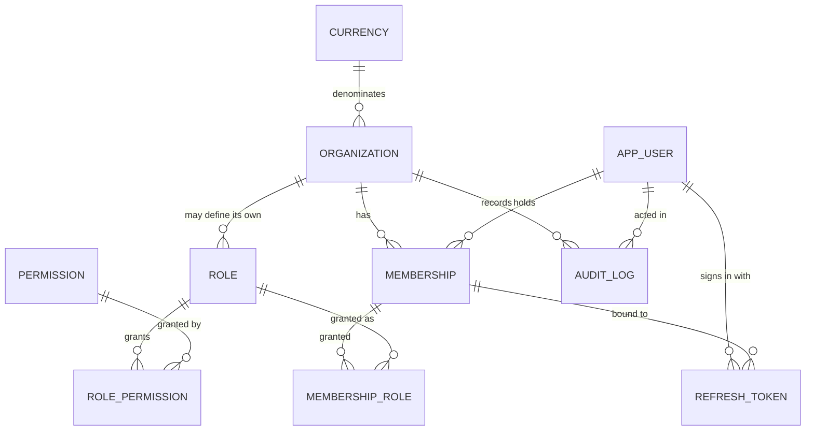
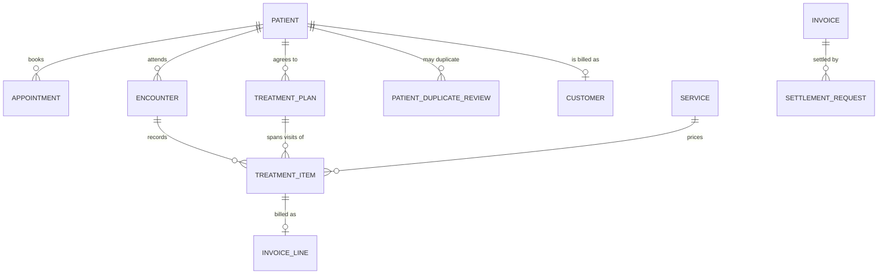

# Database design

PostgreSQL 16+. The schema is managed by Alembic; CI verifies that the
migrations match the models and that they reverse.

## Principles

**UUID primary keys**, generated by `gen_random_uuid()`. Sequential integers
would let one tenant infer another's record count and guess identifiers.

**Timestamps in UTC**, `TIMESTAMPTZ`, named `*_at`. Business dates — a cash
session's day, a receipt date, an accounting period — are `DATE` and are
derived in the organization's timezone, because "which day did this belong
to" is a business question, not an instant.

**Money as `NUMERIC(20, 4)`.** Never `float`, `real` or `double precision`.
See `ACCOUNTING_DESIGN.md`.

**Constraints in the database, not only in code.** Anything the database can
express, it expresses. An application bug must not be able to produce an
unbalanced ledger or a cross-tenant row.

**Explicit constraint names**, via a naming convention on the metadata, so
Alembic generates stable reviewable names and an error message names the rule
that was broken rather than a generated string.

## Tenant isolation

Two redundant mechanisms, because this is the guarantee most worth being
paranoid about.

### 1. Query scoping

Every read of an organization-scoped table goes through
`app.core.tenancy.scoped(stmt, Model, organization_id)`, where the
organization comes from the signed access token. A record belonging to another
tenant is never read, so a 404 reveals nothing about whether it exists
elsewhere.

### 2. Composite foreign keys

Each scoped table carries `UNIQUE (organization_id, id)` — redundant on its
own, since `id` is already unique. Its purpose is to be referenceable: a child
table can then declare

```sql
FOREIGN KEY (organization_id, parent_id)
    REFERENCES parent (organization_id, id)
```

which makes a child whose organization differs from its parent's
**unrepresentable**. Not "rejected by a check that code might forget to call"
— unrepresentable.

`membership_role` already uses this: granting organization A's role to
organization B's membership cannot be stored, however the insert is phrased.
`tests/security/test_tenant_isolation.py` attempts it with raw SQL to prove
the database refuses.

Phase 2 applies the same pattern to `journal_line → journal_entry`, which is
accounting invariant 3.

### Why not row-level security?

Considered and rejected for now; recorded in `DECISIONS.md`. RLS would require
the application to set a session variable on every connection, which is
fragile under connection pooling — a pooled connection carrying the previous
request's tenant context is a cross-tenant read. Explicit scoping is visible
in the query, and it is testable. RLS remains a candidate as defence in depth
once the schema settles.

## Phase 1 schema



| Table | Rows (seeded) | Notes |
| --- | --- | --- |
| `currency` | 4 | Global reference. `decimal_places` is the rounding authority |
| `organization` | — | The tenant. `code` unique; `tax_number` digit-checked |
| `app_user` | — | Global. A person, not an authority |
| `permission` | 67 | Seeded from `app.core.permissions`; FK target for grants |
| `role` | 9 | `organization_id IS NULL` marks a system role |
| `role_permission` | 205 | |
| `membership` | — | **Authority lives here.** Unique per (org, user) |
| `membership_role` | — | Composite FK to membership; see above |
| `refresh_token` | — | SHA-256 digest only; rotation chain recorded |
| `audit_log` | — | Append-only, enforced by trigger |

### Notable constraints

```sql
-- A role code is unique among global system roles, and again within each
-- organization that defines its own. Two partial indexes, not one.
CREATE UNIQUE INDEX uq_role_global_code ON role (code)
    WHERE organization_id IS NULL;
CREATE UNIQUE INDEX uq_role_organization_code ON role (organization_id, code)
    WHERE organization_id IS NOT NULL;

-- A system role cannot belong to one tenant.
CHECK ((is_system AND organization_id IS NULL) OR NOT is_system)

-- Emails are stored lowercase, so uniqueness is case-insensitive without a
-- functional index.
CHECK (email = lower(email))

-- Tax number is digits only, matching the backend and frontend validators.
CHECK (tax_number IS NULL OR tax_number ~ '^[0-9]{9,14}$')
```

## The append-only audit trail

`audit_log` rejects every `UPDATE` and `DELETE`:

```sql
CREATE OR REPLACE FUNCTION audit_log_is_append_only()
RETURNS trigger LANGUAGE plpgsql AS $$
BEGIN
    RAISE EXCEPTION
        'audit_log is append-only: % on audit record % is not permitted',
        TG_OP, COALESCE(OLD.id::text, '(unknown)')
        USING ERRCODE = 'restrict_violation';
END;
$$;

CREATE TRIGGER trg_audit_log_append_only
BEFORE UPDATE OR DELETE ON audit_log
FOR EACH ROW EXECUTE FUNCTION audit_log_is_append_only();
```

A trigger rather than a revoked grant, because the application connects as the
owner of its own schema in most deployments; a trigger holds regardless of
privileges. A test asserts the trigger exists, so a later migration cannot
quietly drop it.

Consequences worth knowing:

- `organization_id` and `actor_user_id` use `ON DELETE RESTRICT`. An
  organization with audit history **cannot be deleted**. That is intended: the
  trail must not be orphaned, and it means the demo organization cannot be
  removed either, so `seed-demo` is idempotent-by-skipping with no `--force`.
- Tests that exercise the independent-transaction audit write leave rows
  behind. Tests therefore stay scoped to their own organization and never
  assume an empty table; the schema is rebuilt once per test session.

## Audit rows join the caller's transaction

An audit record is written into the same transaction as the work it describes.
If a posting rolls back, its "posted" audit record rolls back with it — a
trail claiming things happened which did not is worse than none.

Events that must survive a *failed* request are the exception:

- **A denied permission** is written in its own transaction by
  `record_independently`, before the 403 returns.
- **A rejected sign-in** is written into the request's transaction, which the
  auth router then commits before re-raising
  (`persist_security_side_effects`). This also persists the failed-attempt
  counter that drives account lockout — without it, lockout would never
  trigger, since the error handler rolls the transaction back.

That second case was a real bug found by a test, and the test fixture now
mirrors production's rollback behaviour so it cannot hide again.

## Money columns

```python
MONEY_PRECISION = 20
MONEY_SCALE = 4
MoneyType = Numeric(20, 4, asdecimal=True)
```

`asdecimal=True` keeps values as `Decimal` coming back out of the driver.
20 digits holds ~10¹⁵ UZS, far beyond any plausible amount, and four stored
decimals leave room for intermediate values while posted UZS amounts are
quantized to two.

## Phase 3c schema · the clinic and settlement



| Table | Notes |
| --- | --- |
| `patient` | Almost every column nullable, deliberately: the clinic's own register leaves the birth year and address blank on a good proportion of rows, and records a *year* of birth, not a date. `customer_id` is the one link to the money |
| `patient_duplicate_review` | A suspected duplicate awaiting a human decision. `DISTINCT` is recorded as well as `MERGED`, so the same pair is not raised at every visit |
| `appointment` | A promise about time. Carries nothing financial |
| `encounter` | One visit. Behind `clinic.clinical.read`: complaint, notes, body weight |
| `treatment_plan` | A course of work spanning visits, which is what prosthetics is |
| `treatment_item` | **One tooth, one service, one status.** FDI tooth numbers, checked in SQL as well as in Python. `invoice_line_id` is the single link from clinical work to money |
| `settlement_request` | One submission of the payment form, so it cannot be replayed |

**The clinic stores no balance.** There is no debt column on `patient` and no
price a patient owes on `treatment_item` — only the price basis used and the
invoice line it produced. A patient's debt is read from the sales service,
which derives it from the invoice total and its live allocations. Anything
else would be a second receivables ledger free to disagree with the first,
which is exactly the situation the clinic has today with a paper register on
one side and a spreadsheet on the other.

`settlement_request` looks like an exception and is not: it holds the amounts
as submitted and the ids of the payments they produced, and no balance at all.
Its purpose is the unique `(organization_id, request_key)`, which makes a
double-click, a retried request or a refreshed page settle a bill once.

### Notable constraints

```sql
-- Only completed work is ever billed, and a billed item carries both the
-- line and the price it went out at. Three constraints rather than one, so
-- a violation says which rule was broken.
CHECK (invoice_line_id IS NULL OR status = 'COMPLETED')
CHECK ((invoice_line_id IS NULL) = (billed_at IS NULL))
CHECK (invoice_line_id IS NULL OR unit_price IS NOT NULL)

-- A tooth that does not exist is a typo, and cheaper to catch here than to
-- discover later that a filling was recorded on nothing. FDI notation:
-- 11-18, 21-28, 31-38, 41-48 permanent; 51-55, 61-65, 71-75, 81-85 milk.
CHECK (tooth_number IS NULL
       OR (mod(tooth_number, 10) BETWEEN 1 AND 8 AND (tooth_number / 10) BETWEEN 1 AND 4)
       OR (mod(tooth_number, 10) BETWEEN 1 AND 5 AND (tooth_number / 10) BETWEEN 5 AND 8))

-- An allocation is reversed, never deleted (ADR-038), so uniqueness applies
-- to live rows only: the same payment may legitimately be applied to the
-- same invoice again after a reversal, while a double-click still cannot
-- settle an invoice twice.
CREATE UNIQUE INDEX uq_payment_allocation_live
    ON payment_allocation (organization_id, payment_id, invoice_id)
    WHERE reversed_at IS NULL;
CHECK ((reversed_at IS NULL) = (reversal_reason IS NULL))

-- A written-off debt is not a voided invoice. Voiding reverses the revenue;
-- writing off leaves it standing and clears the receivable to an expense.
-- Separate columns and a separate status, so one cannot be disguised as the
-- other.
invoice.written_off_at, invoice.write_off_reason, invoice.written_off_by_user_id
```

### The over-allocation guard

An invoice can never have more allocated against it than it is worth, and a
payment never more than was received. The rule sums sibling rows, so no
`CHECK` can express it; it is a trigger.

```sql
CREATE TRIGGER trg_payment_allocation_within_limits
    AFTER INSERT OR UPDATE OR DELETE ON payment_allocation
    FOR EACH ROW EXECUTE FUNCTION assert_allocation_within_limits();
```

The function locks the invoice, then the payment — **the same order every
other path takes them** — and sums live rows only, scoped by organization.
Three properties follow, and each was learned the hard way:

* **Live rows only.** The original version, from migration 0003, summed every
  row. When ADR-038 made allocations reversible without updating it, it began
  counting money that had been taken back off, and a legitimate
  re-application after a reversal would have been refused at COMMIT. Migration
  0008 fixed it.
* **Not deferred.** The original was `DEFERRABLE INITIALLY DEFERRED`, which
  meant it fired at COMMIT — and therefore **never fired in the test suite at
  all**, because every test runs in a transaction that is rolled back. That is
  why the bug above was invisible. An immediate trigger raises at the
  statement that caused it, which both names the offending row and makes the
  guard testable.
* **It takes the locks itself.** Without them, two transactions each insert a
  row, each sums without seeing the other, and both pass.

## Concurrency

The scenario to prevent: two cashiers apply the same payment at the same
moment.

| Mechanism | Role |
| --- | --- |
| Unique idempotency key on `posting_event` | **Primary.** The second insert fails regardless of timing |
| Unique `(organization_id, request_key)` on `settlement_request` | **Primary** for a resubmitted payment form. A duplicate blocks on the index rather than reading a stale balance, then replays the first outcome |
| `SELECT ... FOR UPDATE` on the invoice | Serialises concurrent allocations and composite settlements |
| **One lock order: invoice, then payment** | Every path agrees — the allocation service, the composite settlement above it, and the trigger — so two settlements queue instead of deadlocking |
| Allocation sum check under that lock | Prevents over-allocation |
| `trg_payment_allocation_within_limits` | The same check in the database, which holds whatever code path reaches the table |
| Partial unique index on live allocations | The same payment cannot be applied to one invoice twice |
| One transaction per service call | Partial work is impossible |

A preliminary "is this already posted?" check is never the only defence.
Check-then-act is two statements with a gap, and the gap is where the
duplicate appears. The constraint closes it; the check only improves the error
message.

Concurrency tests run the real races on committed connections, because a
check-then-act gap cannot be shown inside one shared transaction: posting the
same event twice, allocating one payment twice, settling one bill from two
sessions, and submitting one payment form twice at once. Each asserts that
exactly one attempt succeeded and that the money moved once.

## Indexes

Beyond primary and unique keys:

- `organization_id` on every scoped table — every query filters on it.
- `audit_log (organization_id, occurred_at)` — the audit view pages by time
  within a tenant, using keyset pagination rather than `OFFSET`, which would
  skip or repeat rows as new events arrive.
- `audit_log (target_type, target_id)` — "what happened to this record".
- `refresh_token (expires_at)` — for the expiry sweep.
- `app_user (email)`, unique — the sign-in lookup.

Phase 2 adds `journal_line (organization_id, account_id, entry_date)`, which
is the access path for the general ledger, account statements and the trial
balance.

## Migrations

One migration per phase, named for it. `0001_phase1_foundation.py` creates the
Phase 1 schema, installs the audit trigger and seeds the permission catalogue,
the nine system roles and four currencies. Where a later revision fixes an
earlier one rather than adding to it — `0008` rewriting the `0003`
over-allocation guard — the downgrade restores the earlier definition
verbatim, bug included, because a downgrade that silently keeps the fix is not
a downgrade.

Seeding reference data **from the Python permission registry** means a role
grant is validated by a foreign key rather than by a string somebody hoped was
spelled right, and the registry stays the single source of truth.

CI runs `alembic upgrade head`, then `alembic check` (schema matches models),
then `downgrade base` and `upgrade head` again (reversible). The test suite
does the same downgrade/upgrade cycle on every run, so reversibility is
continuously exercised rather than asserted once.
