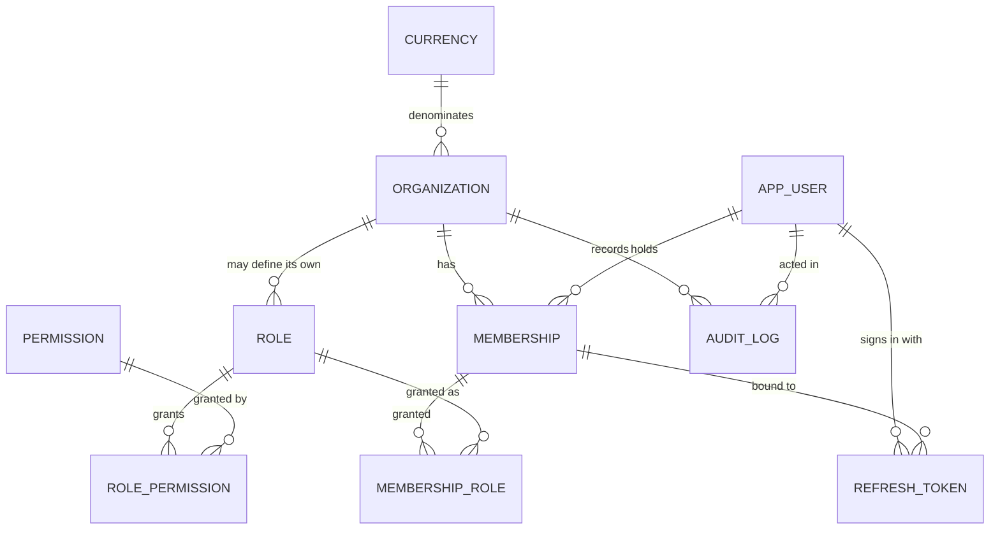

# Database design

PostgreSQL 16+. The schema is managed by Alembic; CI verifies that the
migrations match the models and that they reverse.

## Principles

**UUID primary keys**, generated by `gen_random_uuid()`. Sequential integers
would let one tenant infer another's record count and guess identifiers.

**Timestamps in UTC**, `TIMESTAMPTZ`, named `*_at`. Business dates — a cash
session's day, a receipt date, an accounting period — are `DATE` and are
derived in the organization's timezone, because "which day did this belong
to" is a business question, not an instant.

**Money as `NUMERIC(20, 4)`.** Never `float`, `real` or `double precision`.
See `ACCOUNTING_DESIGN.md`.

**Constraints in the database, not only in code.** Anything the database can
express, it expresses. An application bug must not be able to produce an
unbalanced ledger or a cross-tenant row.

**Explicit constraint names**, via a naming convention on the metadata, so
Alembic generates stable reviewable names and an error message names the rule
that was broken rather than a generated string.

## Tenant isolation

Two redundant mechanisms, because this is the guarantee most worth being
paranoid about.

### 1. Query scoping

Every read of an organization-scoped table goes through
`app.core.tenancy.scoped(stmt, Model, organization_id)`, where the
organization comes from the signed access token. A record belonging to another
tenant is never read, so a 404 reveals nothing about whether it exists
elsewhere.

### 2. Composite foreign keys

Each scoped table carries `UNIQUE (organization_id, id)` — redundant on its
own, since `id` is already unique. Its purpose is to be referenceable: a child
table can then declare

```sql
FOREIGN KEY (organization_id, parent_id)
    REFERENCES parent (organization_id, id)
```

which makes a child whose organization differs from its parent's
**unrepresentable**. Not "rejected by a check that code might forget to call"
— unrepresentable.

`membership_role` already uses this: granting organization A's role to
organization B's membership cannot be stored, however the insert is phrased.
`tests/security/test_tenant_isolation.py` attempts it with raw SQL to prove
the database refuses.

Phase 2 applies the same pattern to `journal_line → journal_entry`, which is
accounting invariant 3.

### Why not row-level security?

Considered and rejected for now; recorded in `DECISIONS.md`. RLS would require
the application to set a session variable on every connection, which is
fragile under connection pooling — a pooled connection carrying the previous
request's tenant context is a cross-tenant read. Explicit scoping is visible
in the query, and it is testable. RLS remains a candidate as defence in depth
once the schema settles.

## Phase 1 schema



| Table | Rows (seeded) | Notes |
| --- | --- | --- |
| `currency` | 4 | Global reference. `decimal_places` is the rounding authority |
| `organization` | — | The tenant. `code` unique; `tax_number` digit-checked |
| `app_user` | — | Global. A person, not an authority |
| `permission` | 67 | Seeded from `app.core.permissions`; FK target for grants |
| `role` | 9 | `organization_id IS NULL` marks a system role |
| `role_permission` | 205 | |
| `membership` | — | **Authority lives here.** Unique per (org, user) |
| `membership_role` | — | Composite FK to membership; see above |
| `refresh_token` | — | SHA-256 digest only; rotation chain recorded |
| `audit_log` | — | Append-only, enforced by trigger |

### Notable constraints

```sql
-- A role code is unique among global system roles, and again within each
-- organization that defines its own. Two partial indexes, not one.
CREATE UNIQUE INDEX uq_role_global_code ON role (code)
    WHERE organization_id IS NULL;
CREATE UNIQUE INDEX uq_role_organization_code ON role (organization_id, code)
    WHERE organization_id IS NOT NULL;

-- A system role cannot belong to one tenant.
CHECK ((is_system AND organization_id IS NULL) OR NOT is_system)

-- Emails are stored lowercase, so uniqueness is case-insensitive without a
-- functional index.
CHECK (email = lower(email))

-- Tax number is digits only, matching the backend and frontend validators.
CHECK (tax_number IS NULL OR tax_number ~ '^[0-9]{9,14}$')
```

## The append-only audit trail

`audit_log` rejects every `UPDATE` and `DELETE`:

```sql
CREATE OR REPLACE FUNCTION audit_log_is_append_only()
RETURNS trigger LANGUAGE plpgsql AS $$
BEGIN
    RAISE EXCEPTION
        'audit_log is append-only: % on audit record % is not permitted',
        TG_OP, COALESCE(OLD.id::text, '(unknown)')
        USING ERRCODE = 'restrict_violation';
END;
$$;

CREATE TRIGGER trg_audit_log_append_only
BEFORE UPDATE OR DELETE ON audit_log
FOR EACH ROW EXECUTE FUNCTION audit_log_is_append_only();
```

A trigger rather than a revoked grant, because the application connects as the
owner of its own schema in most deployments; a trigger holds regardless of
privileges. A test asserts the trigger exists, so a later migration cannot
quietly drop it.

Consequences worth knowing:

- `organization_id` and `actor_user_id` use `ON DELETE RESTRICT`. An
  organization with audit history **cannot be deleted**. That is intended: the
  trail must not be orphaned, and it means the demo organization cannot be
  removed either, so `seed-demo` is idempotent-by-skipping with no `--force`.
- Tests that exercise the independent-transaction audit write leave rows
  behind. Tests therefore stay scoped to their own organization and never
  assume an empty table; the schema is rebuilt once per test session.

## Audit rows join the caller's transaction

An audit record is written into the same transaction as the work it describes.
If a posting rolls back, its "posted" audit record rolls back with it — a
trail claiming things happened which did not is worse than none.

Events that must survive a *failed* request are the exception:

- **A denied permission** is written in its own transaction by
  `record_independently`, before the 403 returns.
- **A rejected sign-in** is written into the request's transaction, which the
  auth router then commits before re-raising
  (`persist_security_side_effects`). This also persists the failed-attempt
  counter that drives account lockout — without it, lockout would never
  trigger, since the error handler rolls the transaction back.

That second case was a real bug found by a test, and the test fixture now
mirrors production's rollback behaviour so it cannot hide again.

## Money columns

```python
MONEY_PRECISION = 20
MONEY_SCALE = 4
MoneyType = Numeric(20, 4, asdecimal=True)
```

`asdecimal=True` keeps values as `Decimal` coming back out of the driver.
20 digits holds ~10¹⁵ UZS, far beyond any plausible amount, and four stored
decimals leave room for intermediate values while posted UZS amounts are
quantized to two.

## Concurrency

The scenario to prevent: two cashiers apply the same payment at the same
moment.

| Mechanism | Role |
| --- | --- |
| Unique idempotency key on `posting_event` | **Primary.** The second insert fails regardless of timing |
| `SELECT ... FOR UPDATE` on the invoice | Serialises concurrent allocations |
| Allocation sum check under that lock | Prevents over-allocation |
| One transaction per service call | Partial work is impossible |

A preliminary "is this already posted?" check is never the only defence.
Check-then-act is two statements with a gap, and the gap is where the
duplicate appears. The constraint closes it; the check only improves the error
message.

Phase 2 adds concurrency tests that post the same event from parallel
transactions and assert exactly one succeeds.

## Indexes

Beyond primary and unique keys:

- `organization_id` on every scoped table — every query filters on it.
- `audit_log (organization_id, occurred_at)` — the audit view pages by time
  within a tenant, using keyset pagination rather than `OFFSET`, which would
  skip or repeat rows as new events arrive.
- `audit_log (target_type, target_id)` — "what happened to this record".
- `refresh_token (expires_at)` — for the expiry sweep.
- `app_user (email)`, unique — the sign-in lookup.

Phase 2 adds `journal_line (organization_id, account_id, entry_date)`, which
is the access path for the general ledger, account statements and the trial
balance.

## Migrations

One migration per phase, named for it. `0001_phase1_foundation.py` creates the
Phase 1 schema, installs the audit trigger and seeds the permission catalogue,
the nine system roles and four currencies.

Seeding reference data **from the Python permission registry** means a role
grant is validated by a foreign key rather than by a string somebody hoped was
spelled right, and the registry stays the single source of truth.

CI runs `alembic upgrade head`, then `alembic check` (schema matches models),
then `downgrade base` and `upgrade head` again (reversible). The test suite
does the same downgrade/upgrade cycle on every run, so reversibility is
continuously exercised rather than asserted once.
